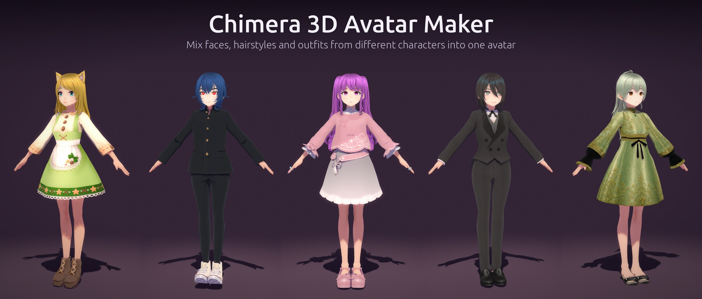
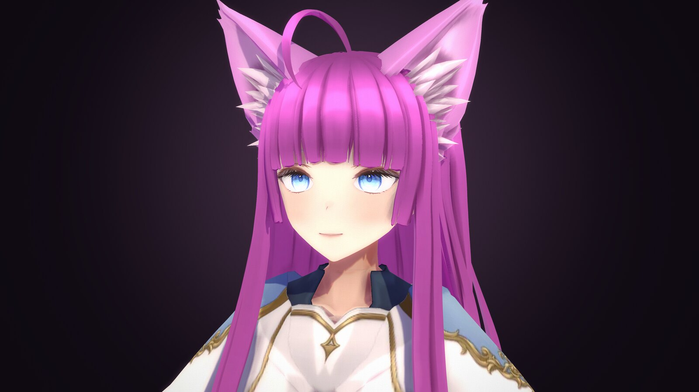
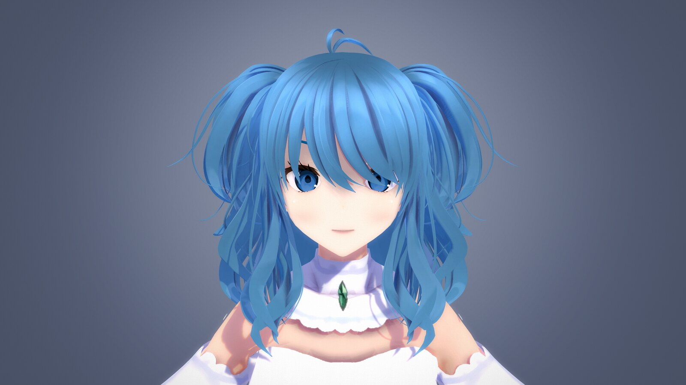
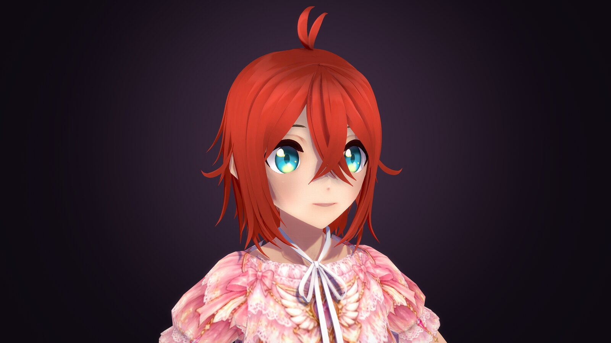
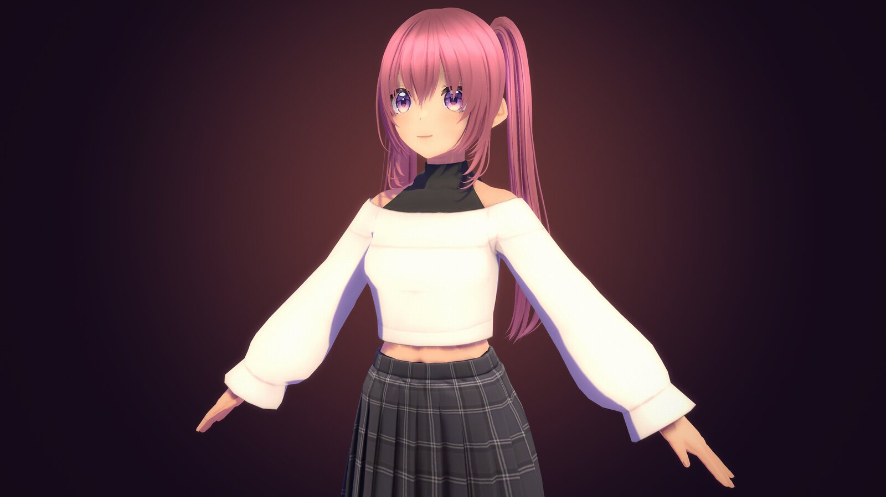
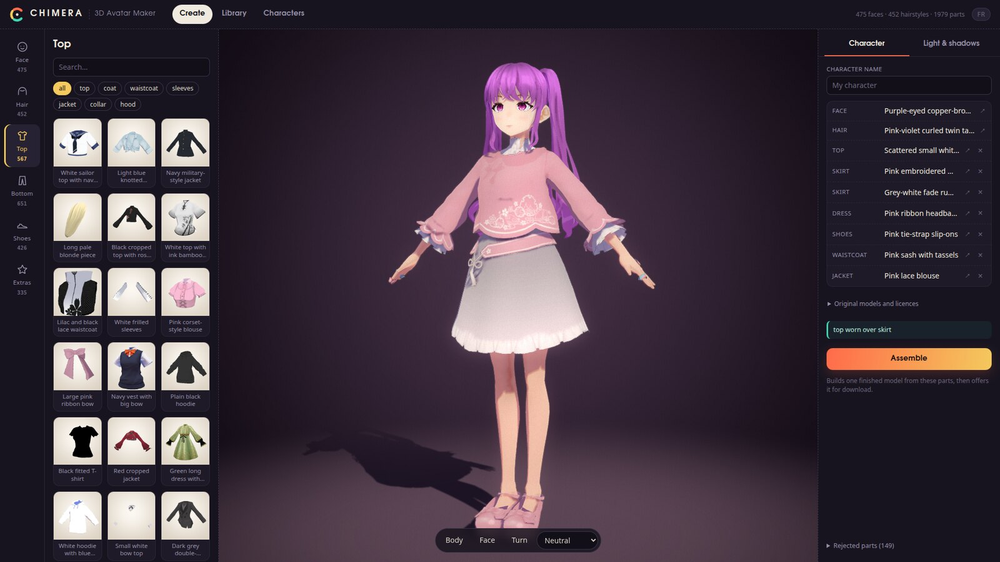
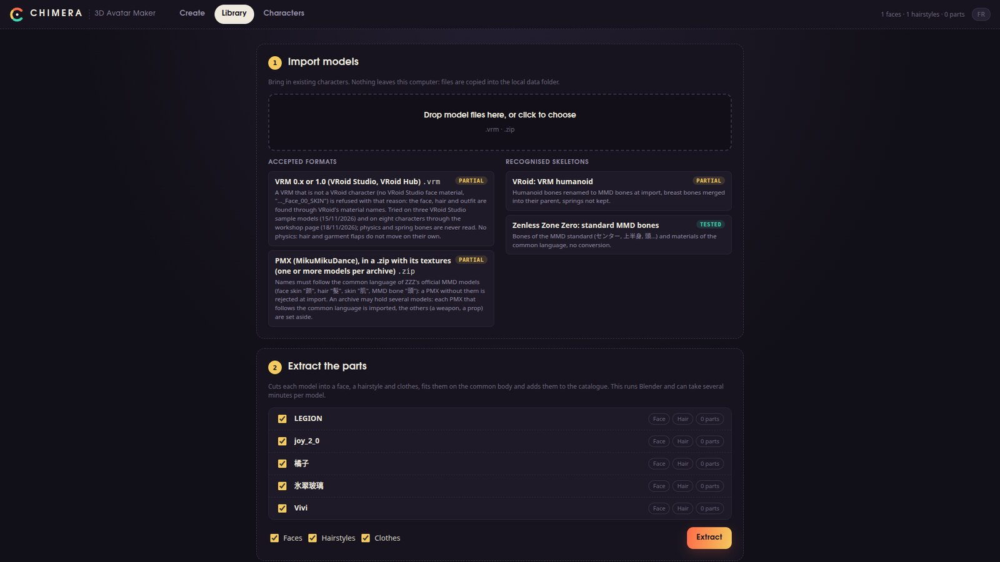
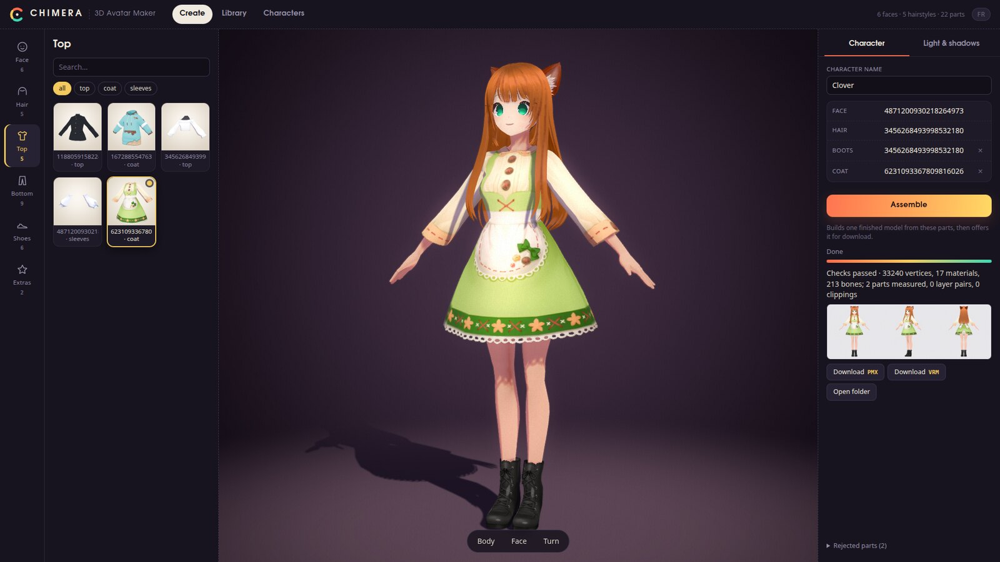

# Chimera 3D Avatar Maker

Build new anime-style 3D characters out of the parts of existing ones.

Chimera is a local web app. You import character models you own, it cuts them into parts (face, hairstyle,
clothes), fits every part on one common body, and lets you mix them: the face of one, the hair of another,
the jacket of a third. The result is exported as a rigged model.

**The repository contains code only. It ships no model, texture or extract.** You bring your own models;
everything stays on your disk.

| | |
|---|---|
|  |  |
|  |  |

Every character shown here is a mix of parts from free, original VRoid Hub models; each part is credited in
[docs/CREDITS.md](docs/CREDITS.md).

The interface is in English and French. The documentation and the code comments are in English.

## What it does

| | |
|---|---|
| **Import** | drop model files on the Library page (one archive may hold several models) |
| **Extract** | one button cuts each model into faces, hairstyles and clothes, and adds them to the catalogue |
| **Create** | pick a face, a hairstyle and clothes; the 3D preview updates as you click |
| **Light & shadows** | light, shadows, skin, outline, background: every setting by hand, saved as a small JSON file you can export, share and import |
| **Export** | each assembled character downloads as PMX (MikuMikuDance) and VRM 1.0 |

| Library: import and extract | An assembled character |
|---|---|
|  |  |

## Supported formats and skeletons

| | level |
|---|---|
| **In**: VRM 0.x (VRoid Studio) | partial: tested on VRoid sample models |
| **In**: PMX (MikuMikuDance) in a .zip with its textures | partial: bone and material names must follow the MMD standard |
| **Out**: PMX (.zip with textures) | no physics |
| **Out**: VRM 1.0 | humanoid bones, 13 expressions, MToon materials |
| Skeleton: MMD standard bones (the official Zenless Zone Zero MMD models) | proven |
| Skeleton: VRM 0.x humanoid (VRoid) | partial |

The Library page shows this list for your installation. Details and limits: [COMPATIBILITY.md](COMPATIBILITY.md).

## Quick start

Linux, Python 3 with numpy, Blender 5.2, a WebGL2 browser. From the repository root:

    python3 -I tools/vroid_base/build.py MyCharacter.vrm   # the base body, from a VRoid Studio character of yours (seconds)
    python3 -I tools/workshop/catalog.py prepare             # the catalogue of the page (needs Blender)
    bin/chimera                                                 # http://127.0.0.1:8767

Then, in the page: **Library** → drop your models → **Extract parts** → **Create**.

The base body comes from a VRoid Studio character that you export yourself (VRM 0.x); the licence of that
file applies to what you build on it. Details, settings and what to do when something is missing:
[INSTALLATION.md](INSTALLATION.md).

## Get the ready-made library

Do you have no models of your own? A prepared library of about 480 VRoid Hub models is available:
[Chimera VRoid Library](https://huggingface.co/datasets/Rose-and-Knight/chimera-vroid-library) on Hugging Face.
Their authors allow redistribution and modification, and each model keeps its author's terms (listed in the
library's `CREDITS.md`). It is about 8.6 GB to download,
checked with sha256 and resumable:

    python3 -I tools/library/library.py install
    bin/chimera

The page then opens on the whole catalogue. Models of your own can still be added, and existing ones are never
overwritten. Details: [INSTALLATION.md](INSTALLATION.md).

Installed it before format 2 (English data names)? Convert it once with
`python3 -I tools/library/library.py migrate <data folder>`, or install it again into an empty folder:
[INSTALLATION.md](INSTALLATION.md#installed-before-format-2).

## Your models, your responsibility

Chimera is a tool: it does not change the rights on what goes through it. Every model keeps the terms of use
of its author or publisher (commercial use, credit, redistribution, forbidden uses), and a character you assemble
must respect the terms of **each** model whose parts it carries.

You are responsible for the rights on the models you import yourself and on the characters you build from them.
The authors of Chimera are not responsible for any use that breaks the terms of a model or a character, whether
it was imported by the user or taken from the ready-made library. Game models usually may not be redistributed,
and neither may parts of them. Never attach a model, a texture or an extract to an issue or a pull request.

## Adding a game or a format

Each game or model family is described by one file, `tools/games/<game>/game.json`.
[CONTRIBUTING.md](CONTRIBUTING.md) explains what a description alone can do and which files of the core must
change otherwise.

## Layout

| path | role |
|---|---|
| `tools/workshop` | the app: catalogue, local server, web page, light and shadow settings, assembly in Blender |
| `tools/workshop/page/presets` | render presets (JSON) |
| `tools/vroid_base` | the base body, face and hairstyle, from a VRoid character you provide |
| `tools/free_base` | fallback base built from the MakeHuman mesh (CC0) |
| `tools/vroid` | VRM 0.x import |
| `tools/games` | one description per game or model family |
| `tools/head`, `tools/clothes`, `tools/hair` | faces, clothes and hair: extraction, fitting, checks |
| `tools/rebuilt_body`, `tools/custom_body`, `tools/rebuilt_head` | building one's own body, skeleton and head |
| `tools/settings.py`, `settings.default.json` | settings; yours go in `settings.json` (not tracked) |

## Licence

Code: MIT, see [LICENSE](LICENSE). Personal and commercial use, modification and redistribution of the code are
allowed, with no warranty. The licence covers the code only: the models, and the characters built from them, stay
under their own terms (see "Your models, your responsibility"). The images in `docs/images` show characters built from third-party VRoid Hub
models, credited in [docs/CREDITS.md](docs/CREDITS.md); the MIT licence does not cover those models.
